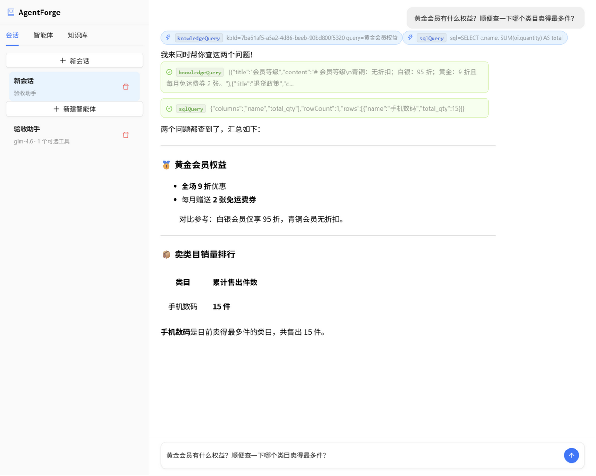
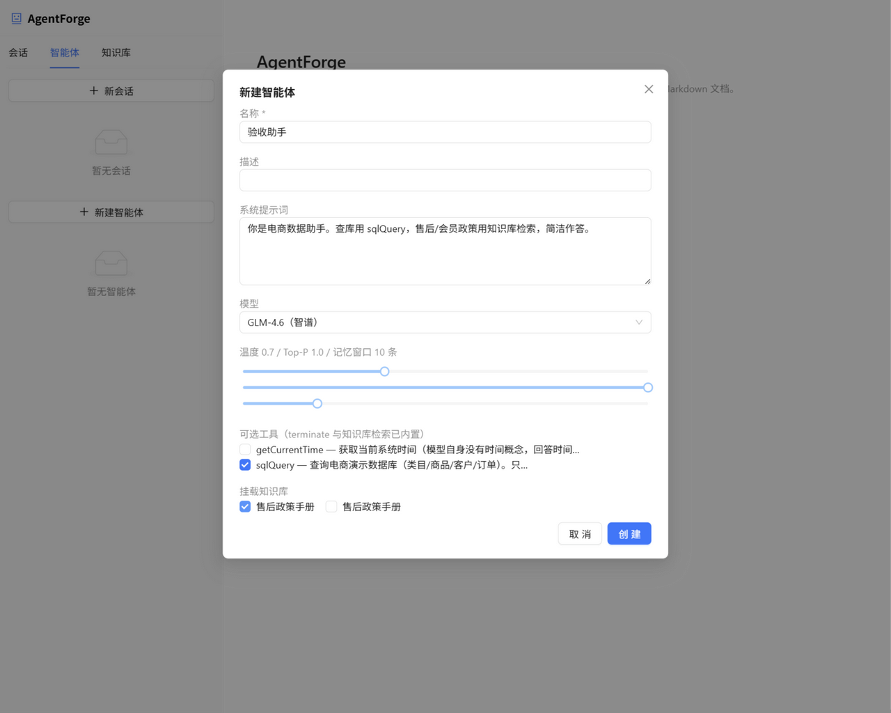

# AgentForge —— AI 智能体助手

基于 **Spring AI** 从零构建的 AI Agent 平台：Think-Execute 自主决策循环 · 工具调用 · RAG 知识库 · SSE 过程实时可视化 · 多模型注册表。

> 它不是聊天机器人，而是 Agent：能自主规划、调用工具、检索私有知识库，把"思考—执行"全过程实时推给前端，重启后记忆完整恢复。



## 核心特性

- ✅ **Think-Execute 循环**：手写 ReAct 状态机（`internalToolExecutionEnabled(false)` + 手动 ToolCallingManager），六条路径全覆盖单测（直接回答 / 一轮工具 / 多轮工具 / terminate 终止 / 超步数 / 异常），最大 20 步
- ✅ **可扩展工具框架**：`AgentTool` 接口 + FIXED/OPTIONAL 分类动态装配（`MethodToolCallbackProvider`）；SqlQueryTool 四层护栏（SELECT 白名单 / 多语句拒绝 / LIMIT 包裹 / 只读角色）
- ✅ **RAG 链路**：Markdown 按标题分块（Splitter 接口化可换策略）→ 智谱 embedding-3 (1024 维) → pgvector L2 相似度检索 → 结果注入 Agent 上下文；上传失败整体回滚
- ✅ **多模型注册表**：`ChatClientRegistry`——Bean 名 = 注册 key = 枚举值三方对齐，新增模型零侵入；GLM-4.6 / DeepSeek 双模型可切换
- ✅ **SSE 过程可视化**：THINKING / EXECUTING / GENERATED_CONTENT / DONE 四类事件全链路推送，前端状态气泡 + 工具调用卡片；未连接不抛错（消息已落库，重连对账）
- ✅ **消息持久化协议**：工具调用/结果随消息元数据入库，按角色完整回放（解决 Spring AI 已知痛点 #2101）
- ✅ **双数据源**：业务库 + eshop 只读演示库（Hikari readOnly + DB 角色双重防护）
- ✅ **77 个测试**：单测（Agent 六路径 / SQL 护栏 / 分块器）+ 连本地 PG 集成测试（CRUD 全链路 / 向量检索 / 级联 / 只读验证）一条命令全跑

## 界面预览

| 智能体配置（模型/温度/工具/知识库单页表单） | 聊天（思考气泡 → 工具卡片 → Markdown 回答） |
|---|---|
|  |  |

## 架构

```
┌────────────────────────────────────────────────────────────┐
│          前端 React 19 + AntD 6 + @ant-design/x             │
│      三管理视图（会话/智能体/知识库） + SSE 聊天主视图        │
└─────────────┬──────────────────────────────▲───────────────┘
              │ REST (22 端点)               │ SSE（4 事件）
┌─────────────▼──────────────────────────────┴───────────────┐
│  Controller(薄) → FacadeService(编排) → Mapper(MyBatis XML)  │
│  ┌───────────────┐ ┌──────────────┐ ┌────────────────────┐ │
│  │ AgentLoop     │ │ RAG          │ │ SseService         │ │
│  │ Think-Execute │ │ Splitter接口 │ │ 连接池+会话级监听   │ │
│  │ 状态机+手动工具│ │ EmbeddingClient│ │ 事件映射          │ │
│  └──────┬────────┘ └──────┬───────┘ └────────────────────┘ │
│         │  ChatEvent(@Async)    │                            │
│  ┌──────▼──────────────────────▼─────────────────────────┐ │
│  │ ChatClientRegistry（Bean名=模型名：glm-4.6/deepseek）  │ │
│  └──────┬────────────────────────────────────────────────┘ │
│  ┌──────▼──────────────┐  ┌─────────────────────────────┐  │
│  │ PostgreSQL agenthub │  │ eshop 只读演示库（SQL 工具）  │  │
│  │ + pgvector 1024 维  │  │ Hikari readOnly + 角色防护   │  │
│  └─────────────────────┘  └─────────────────────────────┘  │
└────────────────────────────────────────────────────────────┘
```

## 技术栈

Spring Boot 3.5 · Spring AI 1.1 · MyBatis · PostgreSQL + pgvector · React 19 · TypeScript · Ant Design 6 · @ant-design/x · Vite

## 快速开始

```bash
# 1. 数据库（PostgreSQL 15+ 与 pgvector），一键初始化（业务库 + 演示库 + 只读角色）
db/init-all.bat

# 2. 环境变量（密钥零明文）
export ZHIPU_API_KEY=xxx DEEPSEEK_API_KEY=xxx

# 3. 后端（:8080）
mvn spring-boot:run

# 4. 前端（:5173）
cd ui && npm install && npm run dev
```

详细环境说明见 [docs/setup.md](docs/setup.md)。

## 项目结构

```
├── src/main/java/com/agentforge/
│   ├── agent/            # AgentLoop 六路径状态机、AgentRuntimeFactory、工具体系
│   ├── rag/              # Splitter 接口、标题分块、embedding 客户端
│   ├── sse/              # SseMessage 四事件、连接池、会话级进度监听
│   ├── config/           # ChatClientRegistry、双数据源、线程池
│   ├── controller/ service/ mapper/ converter/ model/
│   ├── event/            # ChatEvent + @Async 异步执行链
│   └── typehandler/      # float[] ↔ pgvector 映射
├── ui/src/               # React 三视图 + SSE 聊天
├── db/                   # 建库脚本 + eshop 种子数据
└── docs/                 # 设计文档 / 开发日志 / 模块讲解稿
```

## 开发过程文档（面试可深挖）

| 文档 | 内容 |
|---|---|
| [docs/devlog.md](docs/devlog.md) | 开发日志：每步决策、踩坑与修复（双数据源注入抢占、工具结果重复落库、SSE 监听器单例串线等真实 bug 记录） |
| [docs/tech-design.md](docs/tech-design.md) | 技术设计：架构 / 记忆持久化协议 / SSE 事件协议 / 双数据源 |
| [docs/api-contract.md](docs/api-contract.md) | API 契约：22 端点 + SSE 协议 |
| [docs/prior-art.md](docs/prior-art.md) | 竞品调研：Spring AI / LangChain4j / Dify 等 5 项目的借鉴与取舍 |
| [docs/mvp-scope.md](docs/mvp-scope.md) | MVP 范围定稿与验收标准 |
| docs/modules/ | 各模块深挖讲解稿（M3-M8） |

## 测试

```bash
mvn test    # 77 个测试：单元 + 集成（连本地 PG 测试库）
cd ui && npm run build && npm run lint   # 前端 tsc + oxlint 零错误
```
